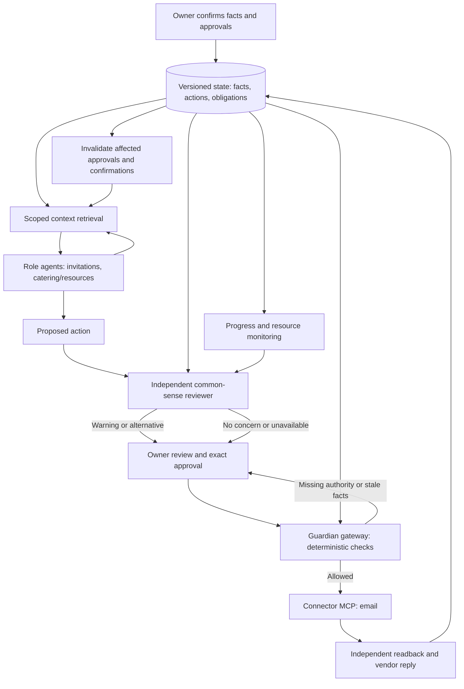
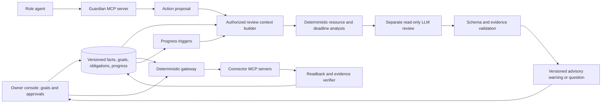
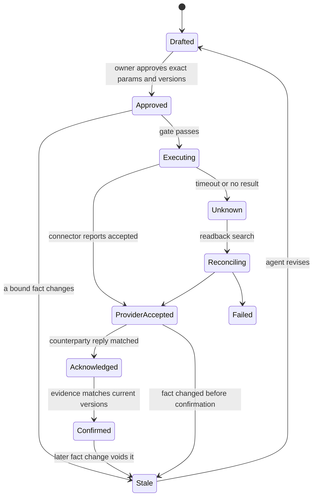

# Goal Guardian — Goal-Aware Event Coordination and Disruption Recovery


> **1 December 2026 delivery scope (PDF review, 25 November):** One reusable Goal Guardian engine, one synthetic TechMeet event, one owner, exactly two independent LLM-driven role agents (Invitations and Catering/Resources), Guardian MCP plus one email connector MCP, and one consolidated owner dashboard. The owner confirms venue facts; transport is not a separate role or required workflow. The minimum reviewer uses one read-only call and shared goal/policy, priority, resource-impact, progress/drift and trigger logic. All external actions use the deterministic gateway; evidence, exact approval, role isolation, deduplication, kill switch and persistent audit remain required. Required evaluation: focused positive/negative controls and reviewer-on/off comparison on identical fixtures. First stretch: grounded cross-agent conflict; optional deeper comparisons, broader qualitative policy, explicit expiry/revocation and hash-chained audit. Excluded for this release: calendar, temporary exceptions/restoration, waivers, incremental context deltas, separate context page, multi-event/production onboarding, exhaustive benchmarks, additional orchestration or custom models. Earlier design catalogue examples and scenario IDs are retained only as background or deferred where explicitly labelled. All implementation claims remain unverified.

**Final integrated idea, technical specification, deliverables and risk analysis (revision 3 — 1 December scope)**
Track 1 (Make MCP Matter) · Selected problem statement · Prepared 24 November 2026

---

## 0. How to read this document

This is a **design and build proposal**, not a record of a working system. Nothing here has been implemented, benchmarked or tested with users.

This revision retains the supplied event recovery proposal and integrates all twelve common-sense capabilities discussed by the team. The user-facing product is **Event Guardian**; the underlying reusable engine is **Goal Guardian**. Disruption recovery remains the flagship workflow, not the entire product. The twelve capabilities are functions of one reasoning service, not twelve separate agents or models. All additions are design proposals, not implementation results.

The original section numbering is retained. New subsections specify the reasoning layer, its data and tool contracts, decision boundaries, evaluation and demo. Original competitor references remain as supplied; no new competitor audit was performed for this revision. The priority and timing estimates are editorial planning choices that the team must confirm.

Statements are tagged where it matters:

| Tag | Meaning |
|---|---|
| **[Doc]** | Taken from the team's *Application Opportunity Report* (24 Nov 2026). Its competitor and evidence notes were not independently re-audited. |
| **[Check]** | Seen in a quick web check on 24 Nov 2026. Descriptions are advertised capabilities, not tested behaviour. |
| **[Judgment]** | Our design opinion or estimate. Treat as a hypothesis. |
| **[Unverified]** | Something we must confirm before relying on it. |

Effort numbers, scores and schedules are rough planning guesses. They exclude integration debugging, which usually dominates.

---

## 1. Executive summary

**The selected problem:** Event planners coordinate venue, catering and invitations in parallel. When a key fact changes (the venue), some finished work becomes invalid, and sending an update email does not prove the vendor accepted it.

**The proposal:** Build **Event Guardian**, a goal-aware coordination assistant powered by Goal Guardian: a versioned source of truth, independent common-sense review service, and enforcement gateway between several independent agents and the controlled email tools and local budget ledger. It does six things:

1. **Stores owner-confirmed facts and obligations outside any agent session**, so a fresh agent with no chat history still sees the current plan.
2. **Invalidates only what a change affects** (the decision-dependency engine, GG-05): the old-address invitation goes stale, the unrelated sponsor receipt stays valid.
3. **Blocks stale or unapproved actions at the execution boundary**, enforced by code, not by asking an LLM to behave.
4. **Separates "attempted" from "confirmed"**: recorded event readiness requires evidence for all mandatory obligations and current required actions.
5. **Questions whether a permissible action is worthwhile**: checks alignment with the owner's objective, competing priorities, resource trade-offs and repeated low-value work before recommending a decision.
6. **Guides recovery and reprioritization**: offers feasible alternatives, flags uncertainty and cross-agent conflicts, and asks the owner to resolve trade-offs instead of autonomously changing goals or spending money.

**One-line pitch:** Event Guardian helps event teams make decisions that still serve the original event objective, prevents outdated or unauthorized actions across independent agents, and verifies that changes have actually been reflected in connected tools.

**The distinction:** a conventional execution check asks whether an action is allowed; the independent reviewer asks whether it is a good idea given the known objectives and circumstances. The gateway retains final authority over execution; the owner retains authority over discretionary decisions.

**What we aim to test:** Whether the Guardian stops stale actions and false "ready" claims, and whether independent review improves goal alignment and resource allocation over competent baselines, at a measured cost in latency, tokens, configuration effort and human interruptions. No improvement is claimed before evaluation.

**What we will not claim:** that this is a new market, that it proves real-world completion, that it saves tokens (unless measured), or that its mechanism is novel in isolation. The novelty is a hypothesis to be tested (Section 9).

**Decision gates:** run a 30-60 minute feasibility test first (Section 16). If a plain dependency workflow gives the same execution result, test whether the independent reviewer adds measurable decision value. If neither mechanism improves outcomes or usability at reasonable cost, narrow the claim or pivot to research integrity, application assurance, or freelancer execution.

---

## 2. The problem

### 2.1 A concrete story (synthetic)

A planner runs a 120-person meetup. In the broader real-world problem, four people might handle venue, catering, invitations and transport; the December demo uses two independent agents and an owner-confirmed venue. On Monday the venue falls through. The owner picks Venue B.

What can go wrong today:

- The invitations agent, working from yesterday's draft, sends the **old address**.
- Catering was confirmed for Venue A. Nobody re-confirmed, but the board still says "done".
- Transport was booked from the old pickup point.
- A new helper, with no history, sees "invitations approved" and sends the batch.
- Someone says "we're all set" while two vendors have not replied.
- Meanwhile the sponsor receipt, which nothing about the venue touches, is needlessly redone because "everything changed".

### 2.2 The failure modes the Guardian targets

| # | Failure mode | Why ordinary tools miss it |
|---|---|---|
| F1 | **Stale action executed** (old address sent) | Task boards show status, but nothing blocks the send itself. |
| F2 | **"Sent" mistaken for "confirmed"** | Email tools report delivery or acceptance, not vendor agreement. |
| F3 | **Over- or under-invalidation** | Either everything is flagged (rework) or nothing is (stale work survives). |
| F4 | **Fresh agent repeats a stale step** | Context lives in the previous session, not in enforced state. |
| F5 | **Shared budget double-spend** | Two agents reserve against the same remaining budget concurrently. |
| F6 | **Premature "ready" claim** | Readiness may be based on a human or agent assertion rather than computed from open obligations. |
| F7 | **Permissible but misaligned action** | A purchase may fit the budget cap but displace resources needed for essential work. |
| F8 | **Goal drift** | A team keeps polishing invitations while time-sensitive catering confirmation is unresolved. |
| F9 | **Local optimization conflicts** | A venue agent minimizes rental cost while a transport agent faces much higher downstream costs. |
| F10 | **Unexamined alternatives and diminishing returns** | A valid plan may be unnecessarily costly or repeatedly revised with little additional benefit. |
| F11 | **Unresolved semantic requirements** | "Keep the event accessible" cannot be fully validated by a single numeric rule; missing information requires clarification. |
| F12 | **Outdated priorities after disruption** | The original work order no longer makes sense once a critical venue or vendor issue arises. |

F7–F12 are proposed reasoning failure modes, not empirically established shortcomings of every existing event product.

### 2.3 What is not a failure of today's tools

A venue-change cascade alone is not novel. **[Doc]** says Bekkn advertises dependency-aware event logistics and vendor coordination, and calendar/task tools support dependencies. Our case tests F1–F6 together with F7–F12: **enforcement at the action boundary, confirmation tracking, scoped context, and independent objective-aware review**. Existing workflow and planning tools can address many of these problems; the incremental advantage must be measured.

---

## 3. Who it is for, and an honest read on user value

**Intended user:** a professional or semi-professional organiser running several concurrent events (small agencies, club or fest committees).

**Honest concerns [Judgment]:**

- Occasional planners are not everyday users. The **[Doc]** itself warns against assuming otherwise.
- Real planners do not typically run multiple autonomous agents today. The multi-agent setup is a plausible near-future workflow, not a current habit.
- **No user interviews or demand measurements exist.** This is a real gap judges may probe.

**Cheap mitigation:** before the pitch, get 3-5 short conversations with real organisers (a college fest committee, a wedding or corporate planner). Ask one thing: "Tell me about the last time a late change broke something you had already sent." One real quote is worth more than any slide.

**Open decision:** pick **one** persona for the pitch (for example, "a small agency running 3 events at once") rather than a vague "event planners".

### 3.1 Cheapest reasonable alternative and why Guardian might help

A shared spreadsheet with owners, deadlines, budget categories and confirmed vendor replies; a calendar; email; and a disciplined change checklist may be sufficient for a small event. A stronger conventional alternative adds workflow dependencies, approval gates, resource reservations and explicit confirmation fields. This is the comparison standard, not a deliberately careless agent.

Guardian is intended for recurring, parallel planning where the cost of keeping these artifacts aligned becomes significant. It can combine version-bound execution, persistent commitments, scoped context and a second opinion grounded in the whole event rather than one agent's local task. It is not intended to replace a capable organizer or invent objectives the organizer never approved. User interviews should also ask whether poor prioritization or expensive late changes matter more than stale communication, how the team handles them now, and whether another approval or warning screen would be acceptable.

---

## 4. Why this was selected, and what the fallbacks are

Event recovery ranked first in our comparison because it has a natural multi-agent handoff, a visual demo (an outdated invitation bouncing), ordinary MCP-style email tools, and measurable failures. GG-05's selective invalidation remains inside this demo. The expanded design restores the original common-sense mechanism alongside it: essential arrangements compete with optional enhancements for a finite budget and time, so valid individual actions may still undermine collective success. Unlike a narrow responsibility handoff, an event provides a natural setting for comparing alternatives, detecting drift, and recommending priorities. This is a design rationale, not a measured superiority claim.

| If the feasibility test shows... | Pivot to |
|---|---|
| No safe real integration, or neither execution nor reasoning improves on a competent baseline | Research claim integrity (if real MCP servers can feed it) |
| Track favours browser or education | Application change and completion assurance |
| Integrations are painful but a gate is easy | Freelancer exact-version approval |

---

## 5. Track fit and the role of MCP

**Track:** Make MCP Matter (Track 1). Fit is **conditional [Doc]** on the official rules and on what our implemented interaction actually does.

**Where MCP genuinely matters here:**

- **Agent-facing Guardian MCP server:** the only surface the agents see (state, propose action, execute action, claim status).
- **Email connector MCP server:** called by the Guardian, not by agents. This shows MCP composition and keeps credentials out of agent hands.

**What MCP is not [Doc]:** the database, the synchronisation algorithm, or the security boundary. The boundary is that **agents hold no direct tool credentials**; they can only act through the gateway.

**Risk:** if judges decide MCP is incidental, we lose on track fit. Make sure at least two separate MCP servers appear in the architecture and demo.

> **First-hour action [Unverified]:** read the official rules and judging rubric. Confirm what counts as "meaningful MCP use", team size limits, pre-existing code rules, and allowed APIs.

---

## 6. Solution overview

### 6.1 Thesis

Instead of passing one growing narrative context to every agent, keep a **shared, versioned representation** of facts, decisions, goals, constraints and evidence. Each agent receives only the records relevant to its task. An **authoritative gateway** enforces the rules regardless of what an agent retrieved or remembers. An independent reviewer receives a server-assembled, authorized view of the overall objective and the action, and produces an evidence-linked advisory judgment. It does not hold connector credentials, approve an action, or rewrite goals.

### 6.2 In scope

Required scope: the scope statement above; one TechMeet, two independent role agents, owner-confirmed versioned goals and facts, typed dependencies, selective invalidation, exact approval, obligation ledger/readiness, evidence verification, atomic claims, single email MCP gateway, scoped snapshots, persistent audit, safety, and one dashboard. One read-only reviewer merges the original capabilities as follows:

| Implementation unit | Original capability IDs | Minimum behavior |
|---|---|---|
| Goal-aware reviewer | CG-01, CG-02, CG-07 | One read-only review; cite confirmed goals and one qualitative accessibility policy; ask when evidence is missing. |
| Progress and drift detector | CG-03, CG-10 | One progress window; distinguish cosmetic repetition from necessary corrections. |
| Resource-impact review | CG-04, narrow CG-06 | Deterministic budget math, essential forecast and feasible alternative; general comparison deferred. |
| Priority model | CG-05, CG-11 | Owner-confirmed tiers plus deadline/dependency-aware next step. |
| Shared recommendation format | CG-08 | Concern, evidence, uncertainty, feasible alternative, next step and recorded owner response. |
| Trigger and deduplication | CG-12 | Relevant proposals, confirmed state changes and deadline checks; suppress repeated findings. |
| Cross-agent conflict | CG-09 | First optional stretch; cite both authorized proposals, redact agent-facing findings. |

Use the original scenario IDs where applicable, not the entire S1–S32 matrix. Run a focused, prelabelled suite: valid send; stale send from fresh session; unaffected receipt; edited/changed approval; missing dependencies; open or missing mandatory requirements; wrong/current vendor replies; duplicate/unknown result; scope/credentials/allowlist/kill switch; concurrent budget reservation; ₹20,000 shortfall and ₹5,000 positive control; cosmetic drift versus required correction; narrow qualitative policy with missing and sufficient evidence; priority recommendation; stale/invalid/unavailable review; favorable advice cannot bypass a hard denial. Compare reviewer ON vs OFF on identical reasoning fixtures with the same gateway, facts, resource math, trigger inputs and owner UI; OFF suppresses LLM judgment, not hard checks. Record expected/observed outcomes, denominators, failed runs, correctness, latency and model usage; no results until measured. Ordinary-agent and competent-workflow comparisons and wider repetitions are optional research, not release gates.

### 6.3 Out of scope (do not build)

All items excluded in the scope statement, plus real vendors/guests/money, autonomous legal or financial decisions, detecting actions outside the controlled path, and generic agent firewall functions. Cross-agent conflict is the first stretch; broader trade-offs, broader qualitative policies, explicit expiry/revocation, audit hash chaining and detailed analytics are optional only.

### 6.4 Engine overview



### 6.5 Hard rules (enforced outside the LLM) [Doc]

- Ambiguous relevance produces a **warning or clarification request, not an automatic veto**. For discretionary choices, the owner may accept or dismiss the warning. A deterministic requirement for owner approval or missing critical dependencies still blocks execution until resolved.
- A semantic review is advisory, versioned and scoped; it cannot grant permission, waive an obligation, change a fact or override a hard rule. A new action or materially changed inputs require a fresh review where review is required by owner policy. If the reviewer is unavailable, display that explicitly and follow the configured human-review fallback; never pretend it approved an action.
- An external source revision may trigger review but **must not silently override the owner**.
- A provider accepting a message is **not proof of real-world completion**.
- Only actions through the controlled path can be blocked. Manual or external changes must be **disclosed and reconciled**, not claimed as prevented.

### 6.6 Full common-sense Goal Guardian capability specification [Judgment — new design]

These twelve features are integrated capabilities of a single independent reviewer, supported by deterministic context assembly, resource calculations, the existing obligation ledger and a progress monitor. The reviewer need not use a different model provider; independence means a separate invocation with a different role, server-selected evidence and no reliance on the proposing agent's self-assessment. Using the same model may still produce correlated errors. Its purpose is to review, explain and suggest; the owner decides and the gateway enforces.

For each feature below, the example is synthetic, the expected behavior is a test target, and the priority applies to the hackathon thin slice rather than the eventual product. P0 means demonstrate a small working case; P1 means richer coverage if time permits. The original twelve IDs are retained for traceability; CG-09 is stretch, and CG-06 is required only in the narrow budget case. Broader examples are not December requirements.

#### CG-01 — Independent Common-Sense AI Judge (P0)

- **Problem:** an agent can follow every instruction and budget rule while choosing a poor overall plan. A proposing agent's own explanation is not an independent check.
- **Inputs:** exact action parameters; applicable owner-confirmed goals, priorities and constraints; current fact versions; outstanding obligations; resource availability; relevant competing actions and trustworthy observations. The review context is assembled by the server, not selected solely by the proposing agent.
- **Mechanism:** a separate read-only LLM call evaluates whether the proposed action is appropriate given the evidence. It returns structured concerns, relevant goal/fact references, assumptions and alternatives. The server validates the output against the supplied references and recomputes numeric comparisons. No tool write credentials, self-approval or authority to change state.
- **Example:** an owner considers a cheaper site (deferred general trade-off example) without considering the documented increase in transport costs. The reviewer flags the total-cost trade-off and asks whether the convenience reduction is acceptable.
- **Acceptance:** a rule-compliant but clearly misaligned proposal produces a grounded warning; an aligned proposal with identical hard constraints is not flagged solely because it costs money. A malformed or unavailable review is visibly marked unavailable.

#### CG-02 — Active Goal Alignment Evaluation (P0)

- **Problem:** completing a local task is not necessarily progress toward the owner's intended outcome.
- **Inputs:** versioned goal records, action purpose and expected benefit, affected obligations, success conditions, current priorities.
- **Mechanism:** map the proposal to relevant goal IDs, distinguish support, conflict and insufficient evidence, and report why. For hard conditions use explicit deterministic checks; for qualitative goals use advisory interpretation. A new instruction inconsistent with the existing objective is proposed to the owner as a possible goal revision rather than treated as an automatic supersession.
- **Example:** an elaborate stage upgrade may conflict with the agreed goal of an accessible, low-cost community meetup even though the invoice fits the cap.
- **Acceptance:** the review cites the actual goal and explains the conflict; a deliberate owner-approved goal revision is respected after versioning, and outdated reviews are not reused.

#### CG-03 — Goal Drift Detection (P0)

- **Problem:** a sequence of individually relevant actions can collectively move effort away from the primary objective. A single action check cannot establish drift.
- **Inputs:** timestamped task proposals and revisions, verified progress, remaining time, resource usage estimates, high-priority open obligations, the active goal version and owner-approved priority policy.
- **Mechanism:** evaluate a bounded rolling window of observed progress. A configurable trigger (for the fixture, three invitation revisions after the owner accepted an adequate design while a vendor deadline is near) produces a review candidate. The LLM explains whether the pattern is justified, rather than treating repetition alone as failure. Material progress, new requirements, and intentional owner-directed refinements are counter-evidence. This does not monitor a person's private activity outside the product.
- **Example:** an invitation agent spends three review cycles refining colors while catering reconfirmation is due in six hours.
- **Acceptance:** warn before another optional refinement when the evidence supports drift; do not warn when the revisions correct changed venue details or fix a required accessibility problem. Reference the sequence, the deadline and the pending obligation.

#### CG-04 — Opportunity-Cost Reasoning (P0)

- **Problem:** an action can be individually affordable while consuming the resources required for a more important obligation.
- **Inputs:** current budget and commitments, outstanding reservations, estimated costs of unmet essentials, remaining time, task durations, deadlines, feasible alternatives and the owner's priority preferences.
- **Mechanism:** compute available resources and counterfactual remaining resources under each option using integer currency units and explicit estimates. The reviewer interprets the consequences and recommends alternatives. Distinguish committed funds, reservations, forecast needs and discretionary headroom to prevent double counting. A forecast is not a hard spending restriction unless the owner explicitly establishes one.
- **Example:** ₹1,00,000 cap, ₹65,000 already committed/reserved, ₹25,000 in unreserved essential forecast needs. ₹35,000 remains under the hard cap, but only ₹10,000 is forecast discretionary headroom. A ₹20,000 decoration proposal fits the cap yet leaves ₹15,000 for essentials, a ₹10,000 projected shortfall. Recommend deferring or reducing the decoration, or obtaining an owner-approved revised plan.
- **Acceptance:** numeric calculations are exact for the fixture, the warning cites the competing essential need, and a ₹5,000 optional purchase with all other conditions unchanged is not falsely labeled as producing a shortfall. Unknown estimates result in a qualification, not invented numbers.

#### CG-05 — Goal Prioritization (P0, basic; P1, richer)

- **Problem:** agents optimize their assigned task without knowing what the owner values most.
- **Inputs:** owner-confirmed priority tiers, deadlines, mandatory obligations, task dependencies and optional improvements.
- **Mechanism:** store explicit priorities such as required, important and optional. Use deadline/dependency rules to identify critical work, and the reviewer to explain ambiguous ranking. Do not infer a universal hierarchy or silently promote an optional item into a mandatory obligation. Ask the owner if two goals conflict and the preference is unspecified.
- **Example:** safe/accessible venue capacity and catering confirmations take precedence over decorative upgrades if the owner defines that policy.
- **Acceptance:** the interface lists the reason for the recommended ordering, respects a confirmed owner reprioritization and never treats a soft preference as a hard execution prohibition.

#### CG-06 — Resource-impact review (merged with CG-04; broader trade-offs optional)

- **Problem:** the cheapest, fastest or most attractive option in isolation may be worse for the event as a whole.
- **Inputs:** comparable alternatives with sourced cost, capacity, travel, availability, accessibility and reliability evidence; hard constraints and explicit priority preferences; unknowns.
- **Mechanism:** deterministic arithmetic and feasibility filters first, then qualitative comparison of non-dominated alternatives. Report known benefits, downsides, unknowns and the conditions under which the recommendation changes. Avoid fabricated scores or pretending that a single weighted total captures every preference. No automatic booking.
- **Example:** Venue B has a ₹30,000 rental and ₹15,000 transport estimate; Venue C has a ₹38,000 rental and ₹4,000 transport estimate. On those two cost items, C is ₹3,000 cheaper overall despite higher rent. Capacity and availability still require verification before selecting it.
- **Acceptance:** the comparison uses complete comparable cost items, excludes options violating confirmed hard constraints, and asks for missing evidence instead of declaring an unsupported winner.

#### CG-07 — Semantic Policy Evaluation (P0, basic; P1, broader)

- **Problem:** qualitative requirements such as “prioritize attendee convenience over luxury” cannot always be reduced to an exact threshold.
- **Inputs:** owner-confirmed natural-language policy text and version, scope, proposed action and verified relevant facts.
- **Mechanism:** evaluate the meaning in context and identify possible conflicts or unknowns. Explicitly distinguish a qualitative advisory policy from a separately encoded hard condition (for example, a fixed cap or verified minimum capacity). An LLM interpretation never independently becomes an enforceable rule; the owner must approve any structured restriction before the gateway uses it.
- **Example:** a distant premium venue might conflict with the convenience preference if participants' travel needs are documented. Without travel or accessibility information, ask rather than guess.
- **Acceptance:** cited policy and facts support the concern; missing evidence triggers clarification; a hard budget violation is denied by code, not by the reviewer.

#### CG-08 — Alternative Action Recommendation (P0, basic; P1, broader)

- **Problem:** a warning is of little use if it leaves the planner at a dead end.
- **Inputs:** blocked or questioned proposal, known alternatives, available resources, required dependencies, existing commitments and approvals.
- **Mechanism:** recommend a small number of concrete next steps (including doing nothing or deferring optional work when appropriate). Check known hard constraints before labeling an alternative feasible. Include remaining unknowns and required authorization. Alternatives are drafts, not actions, and need their own parameter/version binding and approval.
- **Example:** defer the decoration upgrade and reserve only the amount needed for essentials; request missing accessibility evidence before endorsing the plan.
- **Acceptance:** at least one grounded, actionable alternative is presented for the fixture, with its cost or dependency consequence. No invented vendor quote, automatic reservation or unauthorized email.

#### CG-09 — Cross-Agent Goal Conflict Detection (first stretch only)

- **Problem:** different agents can make locally sensible decisions that conflict through shared resources, timing or goals.
- **Inputs:** authorized cross-role summaries of current proposals, required obligations, shared resources and event goals. The reviewer may access an owner-authorized aggregate view that ordinary role agents cannot see in full.
- **Mechanism:** detect deterministic conflicts (such as competing budget reservations) and separately flag semantic conflicts (such as convenience versus a local cost-minimization objective). Present the combined impact and ask the owner to resolve it where necessary. Return only role-appropriate findings; do not reveal unrelated sponsor data.
- **Example:** the invitations agent proposes immediate notification while Catering/Resources proposes waiting for a current confirmation; cite both authorized proposals and explain the conflict.
- **Acceptance:** a cross-role conflict is identified with references to both proposals; unrelated simultaneous work is not flagged, and no private cross-role facts are leaked.

#### CG-10 — Diminishing Returns Detection (P0 through shared drift fixture; P1, general)

- **Problem:** repeatedly refining a satisfactory result may consume time without meaningfully improving the outcome.
- **Inputs:** versioned artifacts or task revisions, the owner's definition of acceptable completion, measured or estimated effort, remaining critical work and meaningful improvement signals.
- **Mechanism:** compare incremental benefit across revisions against resource consumption and outstanding priorities. A heuristic flags candidates; the LLM assesses whether changes are material. Avoid claiming a real numeric return unless a measurable benefit exists. Different from CG-03: a single task may have diminishing returns even if the team is still pursuing the overall goal; drift is a broader trajectory.
- **Example:** further color adjustments after approval add no required information to invitations, while vendor coordination is still pending.
- **Acceptance:** distinguish cosmetic repetition from required fixes (correcting venue, accessibility or guest information). Recommend stopping or deferring optional refinement only when justified.

#### CG-11 — Intelligent Task Reprioritization (P0, basic; P1, broader)

- **Problem:** the work sequence that made sense before a disruption may be inappropriate afterward.
- **Inputs:** fresh fact versions, invalidated actions, obligation deadlines, dependencies, role ownership, estimated effort and priority policy.
- **Mechanism:** compute an eligible set of tasks using known prerequisites and deadlines; recommend a revised order with reasoning. Mark tasks needing reapproval or confirmation. Do not move a responsibility to another person or change a deadline without authority. Recompute when relevant state changes.
- **Example:** venue change reopens catering confirmation; recommend completing that and correcting the invitation before spending time on optional visuals.
- **Acceptance:** the suggested ordering respects dependencies and current priority rules, leaves unaffected sponsor reconciliation valid, and does not falsely declare an unfinished task completed.

#### CG-12 — Proactive Goal Guardian Intervention (P0)

- **Problem:** waiting until an agent attempts an irreversible action is too late for efficient recovery.
- **Inputs:** proposed actions, fact changes, approaching deadlines, unresolved obligations and progress-window triggers.
- **Mechanism:** invoke the independent review on consequential proposals and on material event-driven triggers; a small local scheduler or explicit demo clock handles deadlines. Produce structured warning cards with evidence, affected goals, alternatives and next action. Deduplicate by concern type, action revision and relevant versions; re-alert only if material facts, severity or the owner-defined escalation threshold change. For the demo no external notifications are sent without the same guarded authorization as other sends.
- **Example:** alert the owner about a near catering deadline while there is still time to obtain confirmation, rather than after the event is marked ready.
- **Acceptance:** warning appears before the contemplated action or deadline in a reproducible fixture; an owner can dismiss or resolve it; no repeated identical warning loop or uncontrolled external action occurs.

### 6.7 Capability mapping to the original Goal Guardian concept

| Original mechanism | Event Guardian design coverage | Hackathon demonstration |
|---|---|---|
| Independent common-sense judge | CG-01, separate read-only review | Rule-compliant poor decision questioned |
| Original goal preservation | Goal registry, owner authority, CG-02/05 | Original goal and priority references |
| Goal drift detection | CG-03, progress journal | Three optional revisions vs near deadline |
| Opportunity-cost reasoning | CG-04 | Forecast essential-funding shortfall |
| Persistent commitment memory | Obligation ledger | Pending vendor confirmation across sessions |
| Cross-agent context continuity | Shared versioned state | Fresh invitation agent with no history |
| Versioned context | Field-level facts and goal versions | Venue changes from v2 to v3 |
| Selective dependency invalidation | Explicit dependency model | Invitations stale; sponsor receipt unaffected |
| Efficient task-specific context sharing | Scoped snapshots, measured usage | Basic role view; incremental retrieval excluded |
| Deterministic policy engine | Server-side rules | Hard denial with reason code |
| Semantic policy evaluation | CG-07, owner-confirmed policy | Convenience versus optional upgrades |
| Controlled MCP gateway | Agent-facing server + connector MCP | Actual test tool-call trace |
| Explicit human approval | Exact parameters, bound fact versions | Corrected invitation reapproved |
| Independent outcome verification | Provider readback and matching reply | Wrong-version reply cannot close obligation |
| Audit trail and explanations | Decision history, evidence, warning dispositions | Block explanation and reviewer rationale |

The retained mechanisms above define the narrowed release; temporary exceptions and incremental deltas are excluded, broader reasoning optional. None are asserted implemented or tested. Application-level memory is not model-level KV-cache sharing.

### 6.8 Two complementary kinds of protection

| Deterministic gate | Independent reviewer |
|---|---|
| Is this action authorized, current, and within hard limits? | Is this a sensible action in light of the objective and alternatives? |
| Uses explicit state, permissions, versions and evidence requirements | Uses server-assembled evidence, deterministic calculations and an LLM's advisory judgment |
| DENY, REQUIRE_APPROVAL, REQUIRE_CLARIFICATION, ALLOW_EXECUTION, or UNKNOWN/RECONCILE | NO_CONCERN_FOUND, WARN, ASK, or UNAVAILABLE; never an execution permission |
| Owner cannot bypass invariant checks with an ordinary approval | Owner may consciously accept an advisory trade-off, with a recorded reason |
| A budget overrun is rejected | A discretionary expense that fits the cap but jeopardizes essential work is questioned |

A hard rule remains a hard rule even if the reviewer is optimistic. A soft warning is not an automatic veto. No concern found is not proof of optimality or real-world safety.

---

## 7. Where it is good

| Strength | Why it matters |
|---|---|
| **Natural parallel work** | Different event responsibilities provide a realistic coordination setting, although the four-autonomous-agent deployment remains a constructed prototype. |
| **Two distinct checks** | The gateway protects invariants; the reviewer can question rule-compliant but counterproductive actions. |
| **Measurable trade-offs** | Synthetic budget shortfalls, near deadlines and revision histories provide testable inputs to advisory reasoning. |
| **Vivid, fast demo** | A stale invitation visibly bouncing is understood in seconds, even by non-technical judges. |
| **Measurable outcomes** | Stale actions reaching the provider, false blocks, unresolved obligations, tokens to unrelated agents, rework, time to recover. |
| **Deterministic core** | Critical checks are code. This answers "isn't this just another LLM judge?" |
| **Ordinary MCP tools** | One controlled email workflow needs no exotic integrations. |
| **Cheap infrastructure** | SQLite, a small API, no GPU. Feasible for a small team in a short window. |
| **Composable** | GG-05 selective invalidation, GG-01 exact-version approval and the shared advisory reviewer sit in one engine. |
| **Safe to demonstrate** | Synthetic data, test accounts, harmless sends. |
| **Honest evaluation as a differentiator** | Most demos show only the happy path. A baseline comparison with variance and disclosed failures stands out. |

---

## 8. Where it lacks

Severity is our judgment: **High** can sink the project, **Medium** weakens it, **Low** is polish.

| # | Weakness | Severity | What to do about it |
|---|---|---|---|
| W1 | **"Just a dependency tracker" objection.** Workflow engines, lineage tools and event products already do dependency cascades. A competent baseline with a server-side check at the send tool would match our gate. | High | Sharpen the claim to: enforcement at an agent-facing boundary, confirmation-vs-attempt tracking, scoped context for history-less agents. Measure setup effort honestly. Accept that the technical claim may shrink to usability and integration. |
| W2 | **The vendor is simulated.** The headline idea ("vendor confirmed") is the part we must fake. | High | Use a **real second inbox** for the vendor. The reply is parsed and matched. Disclose that vendors are team-controlled. |
| W3 | **Demand is unproven.** No interviews, no market data. | High | 3-5 quick organiser conversations. Pick one persona. |
| W4 | **Multi-agent event planning is a constructed scenario.** | Medium | Frame it as the emerging workflow, and show the same failure with one agent plus a new session or a human handoff. |
| W5 | **Novelty is a hypothesis.** Pinning, policy gates and approvals exist elsewhere. | Medium | Do not claim novelty of components. Claim the tested combination at a specific boundary. |
| W6 | **MCP necessity is arguable.** A plain REST API could serve the same mechanism. | Medium | Show MCP composition (agent-facing server plus connector servers) and per-agent scoped tool lists. |
| W7 | **Dependency edges can be wrong or missing.** | Medium | Typed action templates with declared dependency fields; unknown critical dependencies fail closed to owner acknowledgement. |
| W8 | **Confirmation parsing is brittle.** | Medium | Structured reply tokens and owner fallback. State the limit. |
| W9 | **Scope is large for the time available.** The original Section 15 list was already large; the independent review adds work. The revised thin slice must be scoped explicitly. | Medium | Strict P0/P1/P2 cut line (Section 15). |
| W10 | **Audience is narrow and episodic.** | Low-Medium | Persona selection and a one-line "why now". |
| W11 | **No benchmark or user study exists for any score in this document.** | Low | Say so in the pitch. |

### 8.1 New reasoning-specific weaknesses

| Weakness | Severity | Mitigation |
|---|---|---|
| The judge may hallucinate costs, infer priorities or overrule intentional choices | High | Validate cited references; compute numbers outside the LLM; version goals; keep owner authority. |
| A single well-prompted agent may make the same recommendations | High | Compare against a competent agent with the same evidence and a deterministic-only ablation; do not claim separation alone improves accuracy. |
| Repeated warnings create alert fatigue or stall planning | Medium | Materiality triggers, deduplication, owner dispositions, bounded review budget and positive controls. |
| Cost and duration estimates may be wrong | Medium | Distinguish forecast from actual; expose provenance, ranges, unknowns; request current quotes. |
| Reviewer needs broader context than an ordinary role agent | High | Explicit owner-authorized service scope; restrict and redact returned findings. |
| Local rules and LLM recommendations may disagree | Medium | Code owns hard decisions. Display disagreements without allowing the LLM to override. |
| Measuring subjective alignment is harder than testing a stale send | High | Prelabel scenarios with an owner rubric, blinded human adjudication where available, report ambiguous cases separately. |

---

## 9. Competitive and adjacent landscape

**Event and workflow products [Doc]:**

- **Bekkn** (https://bekkn.com/) advertises dependency-aware event logistics and vendor coordination.
- Calendar and task products support dependencies.

**Adjacent "guard layer" products [Check, 24 Nov 2026, not tested]:**

- **ai-runtime-guard** (https://pypi.org/project/ai-runtime-guard/) is described as an MCP server enforcing policy before file and shell actions, with approvals, backups, audit, per-agent policy overrides, and optional simulation gating and cumulative budget limits.
- **Heldfast** (https://pypi.org/project/heldfast/) and **Warden** (https://pypi.org/project/warden-mcp/) pin MCP tool definitions and block or quarantine them when they change.
- Writers on agent-driven infrastructure argue for a deterministic gate between an agent's proposal and execution, with credentials held only by the executor.

**Mechanisms to respect [Doc]:** version control and CI gates, workflow engines with durable state and human approval, lineage tools (Power BI impact analysis, dbt exposures), same-model prefix caching, semantic governance tools.

### What this means for our pitch

| Do not pitch | Pitch instead |
|---|---|
| "A policy firewall for agents" | "A world-state-aware execution gate" |
| "Spend-cap warnings" (already offered elsewhere) | A minor optional feature |
| "Dependency graph for events" | "Selective invalidation plus enforcement plus verified closure" |
| "We save tokens" | Only report token numbers we measured, with judge and retrieval calls included |

**Our defensible residual (hypothesis):**

1. Obligations and approvals that **persist across agents**, bound to **versions of real-world facts** (not tool definitions).
2. **Selective** invalidation with a gate that cannot be bypassed, because agents hold no tool credentials.
3. **Verified closure** that distinguishes provider acceptance from counterparty confirmation.

4. Independent, evidence-linked review of rule-compliant but potentially counterproductive choices, using the same versioned event state as the gateway.
5. Observed progress and competing resource requirements inform advice and reprioritization, not a hidden authority to block or change plans.

If a conventional dependency graph plus a policy engine matches the execution behavior, **we reduce that claim** to usability, integration or measured overhead. If a competent planning agent or workflow with equivalent inputs also matches the reasoning outcomes, we reduce the reasoning claim too. Existing semantic governance, LLM judges, project-management prioritization and optimization tools must be included in a future focused competitor audit. The supplied references do not establish that the combined approach is novel.

---

## 10. Architecture

### 10.1 Components

| Component | Responsibility | Notes |
|---|---|---|
| **State store** | Versioned facts, actions, approvals, obligations, evidence, audit log | SQLite for the prototype. Postgres only if needed. |
| **Dependency model** | Which actions and obligations depend on which facts | Explicit edges from typed action templates. |
| **Invalidation engine** | On a confirmed fact change, marks affected actions and approvals stale and reopens obligations | Deterministic. |
| **Approval service** | Binds an approval to exact parameters plus bound fact versions | Only the owner can approve. |
| **Obligation ledger** | Required follow-ups, closure rules, computed readiness | Closure requires evidence. |
| **Guardian gateway** | Runs all pre-execution checks and executes through connectors | The single execution path. |
| **Evidence verifier** | Readback and vendor-reply matching | Statuses: attempted, provider-accepted, acknowledged, confirmed. |
| **Context broker** | Returns scoped snapshots per agent role | Also accounts for tokens supplied. |
| **Independent common-sense reviewer** | CG-01–12: goal alignment, drift, resource trade-offs, semantics, alternatives and prioritization | Minimal live advisory review P0; richer coverage P1. No write access or veto. |
| **Goal and priority registry** | Owner-confirmed objectives, success conditions, hard limits and soft preferences | Versioned in shared state, not agent prompts. |
| **Progress monitor** | Task revisions, deadlines, resource signals and material-change triggers | Bounded event journal and deduplicated review requests. |
| **Resource analysis** | Computes budget headroom, forecast obligations and candidate costs | Deterministic math with explicit estimates. |
| **Agent-facing Guardian MCP server** | Exposes the safe tool surface to agents | Per-agent identity. |
| **Email connector MCP server** | Email only, held by the Guardian | Agents cannot call them. |
| **Owner console** | Approvals, status board, stale markers, audit view | Human interface, not an MCP tool. |
| **Evaluation harness** | Runs focused scenarios with reviewer on/off | Records metrics and variance. |

### 10.2 Trust boundaries

```
+-------------------------+        +-------------------------------+
| Agent sessions (x2)     |  MCP   | Guardian MCP server + gateway |
| no tool credentials     +------->+ state, checks, approvals      |
| scoped context only     |        +---------------+---------------+
+-------------------------+                        | holds credentials
                                                   v
                                    +--------------+--------------+
                                    | Connector MCP servers       |
                                    | email (test acct) |
                                    +--------------+--------------+
                                                   v
                                             Test inboxes
```

**The critical rule:** if any agent can reach email or a vendor tool directly, the gate is theatre. Agents get **only** the Guardian's tools. Credentials live in the Guardian process and are never placed in prompts, config files given to agents, or logs.

### 10.3 Agent identity

Each agent session needs a distinct identity so scopes work.

- **[Check]** One MCP guard project notes that, with local stdio servers, identity is usually tied to profile configuration, not per-instance runtime authentication.
- **Options:** (a) one HTTP (streamable) endpoint with a per-agent bearer token; (b) one stdio process per agent with its own environment variable. Option (b) is simpler for a short build, (a) is more realistic. **[Unverified]** Confirm what our chosen MCP client supports.

### 10.4 Human approval channel

Owner approvals go through the **console**. MCP elicitation could also prompt the owner from a client, but support varies by client. **[Unverified]** Do not depend on it for the demo.

### 10.5 Independent review architecture and trust boundary



The reviewer is a service principal, not a fifth operational role with unrestricted tools. It reads the minimum authorized cross-role aggregate needed to assess the event. It cannot mutate facts or call connectors. The gateway receives review metadata but never treats it as authorization. Warnings can be shown to an agent only after redaction to its role scope; owner sees full authorized detail. For the prototype, one backend process with separate functions, permissions, and model calls is sufficient. No extra orchestration framework is required.

### 10.6 Review scheduling and failure handling

- On a consequential proposal, build a consistent server snapshot, compute known feasibility and resource signals, then invoke the reviewer once per relevant revision. On material state changes or deadline triggers, review impacted pending decisions and priority ordering.
- Deduplicate using action revision, goal versions, referenced fact versions and signal digest. Use bounded retries, configurable rate limits and a model timeout; log unavailable or invalid results distinctly. Do not pretend a cached result is current after a relevant change.
- The owner may explicitly request human-only review if the model fails. For actions configured to require review, require an actual owner decision before execution when the model is unavailable. Unaffected actions with no review requirement may continue through normal checks.
- Do not route every simple read or routine deterministic calculation to the LLM. This saves unnecessary calls as a design goal; measure the actual overhead. No external alert, booking, spend or message is authorized by a recommendation.

---

## 11. Data model and contracts

All of the following is an **illustrative sketch**, not an implemented schema.

### 11.1 Facts are field-level and versioned

Field-level facts make selective invalidation easy: changing `venue.capacity` should not invalidate an invitation that depends only on `venue.address` and `event.start`.

```sql
CREATE TABLE facts (
  workspace   TEXT NOT NULL,
  id          TEXT NOT NULL,                -- e.g. 'venue.address'
  version     INTEGER NOT NULL,
  value_json  TEXT NOT NULL,
  status      TEXT NOT NULL CHECK (status IN ('proposed','owner_confirmed','superseded')),
  source      TEXT, changed_by TEXT, changed_at TEXT NOT NULL,
  PRIMARY KEY (workspace, id, version)
);

CREATE TABLE actions (
  id              TEXT PRIMARY KEY,
  workspace       TEXT NOT NULL,
  type            TEXT NOT NULL,            -- 'send_invitation_batch', 'send_catering_update', ...
  proposed_by     TEXT NOT NULL,
  params_json     TEXT NOT NULL,
  params_hash     TEXT NOT NULL,            -- hash of canonical params
  status          TEXT NOT NULL,            -- see 11.3
  idempotency_key TEXT UNIQUE,
  created_at      TEXT NOT NULL
);

CREATE TABLE action_deps (                  -- explicit dependency edges
  action_id    TEXT NOT NULL,
  fact_id      TEXT NOT NULL,
  fact_version INTEGER NOT NULL,            -- version the action was prepared against
  PRIMARY KEY (action_id, fact_id)
);

CREATE TABLE approvals (
  id                 TEXT PRIMARY KEY,
  action_id          TEXT NOT NULL,
  params_hash        TEXT NOT NULL,         -- exact params approved
  bound_versions_json TEXT NOT NULL,        -- {fact_id: version}
  approver           TEXT NOT NULL,
  approved_at        TEXT NOT NULL,
  expires_at         TEXT,
  status             TEXT NOT NULL CHECK (status IN ('active','invalidated','used','revoked')),
  reason             TEXT
);

CREATE TABLE obligations (
  id                  TEXT PRIMARY KEY,
  workspace           TEXT NOT NULL,
  description         TEXT NOT NULL,
  kind                TEXT NOT NULL,        -- 'confirmation','verification'
  depends_json        TEXT NOT NULL,        -- fact ids and versions it relies on
  required_evidence   TEXT NOT NULL,        -- e.g. 'vendor_reply_matching_venue_version'
  status              TEXT NOT NULL CHECK (status IN ('open','pending_verification','closed')),
  created_from        TEXT,                 -- action or fact change
  closed_by_evidence  TEXT
);

CREATE TABLE evidence (
  id TEXT PRIMARY KEY, obligation_id TEXT, action_id TEXT,
  kind TEXT NOT NULL,                       -- 'provider_ack','vendor_reply','readback'
  source TEXT NOT NULL, payload_hash TEXT NOT NULL,
  matches_versions_json TEXT, observed_at TEXT NOT NULL
);

CREATE TABLE budget_reservations (
  id TEXT PRIMARY KEY, workspace TEXT, category TEXT,
  amount INTEGER NOT NULL, action_id TEXT, status TEXT NOT NULL
);

CREATE TABLE audit_log (                    -- append-only (hash chaining optional)
  seq INTEGER PRIMARY KEY AUTOINCREMENT,
  ts TEXT NOT NULL, actor TEXT NOT NULL, event TEXT NOT NULL,
  payload_json TEXT NOT NULL
);
```

### 11.2 Typed action templates (reduce reliance on LLM-guessed dependencies)

| Action type | Depends on facts | Protected? | Required obligation after execution |
|---|---|---|---|
| `send_invitation_batch` | `venue.address`, `event.start`, `guest_list.version` | Yes | None (delivery readback) |
| `send_catering_update` | `venue.address`, `headcount`, `event.start`, `menu.version` | Yes | Vendor confirmation matching venue version |
| `reserve_budget` | `budget.cap`, `budget.committed` | Yes | None (atomic) |
| `reconcile_sponsor_receipt` | `sponsor.amount` | No | None |

**The agent proposes parameters. The template, not the agent, declares dependencies.** An LLM may *suggest* an extra edge, but an owner must confirm it before it counts as critical.

### 11.3 Action status model



### 11.4 Illustrative state change [Doc]

```yaml
project: synthetic-event
changed_fact:
  id: venue.address
  old_version: 2
  new_version: 3
  status: owner_confirmed
impact:
  - action: send_invitation_batch
    status: stale
    reason: approved_address_changed
  - obligation: obtain_catering_confirmation
    status: open
    reason: supplier_has_not_confirmed_new_venue
  - action: reconcile_unchanged_sponsor_receipt
    status: unaffected
```

### 11.5 Goal, progress and advisory-review records [Judgment — schema extension]

The original fact/action/approval/obligation/evidence schema remains. Add the following logical records (SQLite tables or structured JSON fields in the prototype). Every record is workspace-scoped. Use IDs and versions rather than attaching a growing transcript to every agent call.

| Record | Minimum fields | Authority and lifecycle |
|---|---|---|
| `goals` | workspace, goal_id, version, objective, success_conditions, priority tier, status, owner_id, source, timestamps | Proposed → owner_confirmed → superseded. Only owner can confirm or revise; previous versions retained. |
| `policies` | policy_id, version, text, hard/soft kind, scope, optional structured hard predicate, owner confirmation | LLM may propose a candidate; hard predicate must be explicitly confirmed and supported by the gateway. |
| `task_progress` | task_id, role, goal_ids, priority, due_at, dependencies, revision_id, outcome, evidence refs, observed_at, estimated effort | Record observable changes; separate agent estimates from independently verified completion. |
| `resource_forecasts` | resource_id, related obligation, amount or duration, range if known, provenance, as_of, certainty, included_in_reservation | Forecasts separate from committed amounts; stale or missing estimates are explicit. |
| `reviews` | review_id, target action/revision or progress window, policy/goal/fact versions, input hash, trigger, model/version, verdict, findings JSON, created_at, status | Current, stale, invalid, unavailable; generated by read-only service, not an approval. |
| `review_dispositions` | review_id, owner_id, disposition, reason, timestamp, replacement action_id if any | Accepted recommendation, dismissed/accepted trade-off, clarification requested, resolved. Does not authorize execution. |
| `review_triggers` | trigger_id, type, target, state revision, dedupe key, queued_at, status | One review per material trigger; explicit retry budget and unavailable status. |

Add `required`, deadline, evidence predicate (no waiver) to obligations and required-action metadata to actions, because readiness cannot be inferred from whatever records happen to exist. Create mandatory obligations when the owner confirms the event plan, not only after an action occurs. Keep each action's revision immutable after approval; create a new revision for edits. Record approval expiration and explicit revocation checks. The original SQL and pseudocode are sketches, not executable migrations; these extensions clarify missing fields and invariants before coding.

#### Example owner-confirmed goal policy (synthetic fixture)

```yaml
workspace: techmeet-test
objective:
  id: event_success
  version: 1
  description: Deliver a reliable, accessible community meetup for 120 guests
  success_conditions:
    - Current venue and capacity confirmed
    - Required catering arrangements confirmed
    - Current invitation information verified in test inbox
hard_constraints:
  - id: cap
    amount_inr: 100000
  - id: capacity
    minimum_attendees: 120
soft_preferences:
  - id: P1
    text: Prioritize attendee convenience and reliable essentials over luxury
  - id: P2
    text: Avoid optional refinements that delay mandatory confirmations
priorities:
  required: [venue, catering_confirmation, accurate_invites]
  important: [attendee_convenience]
  optional: [decor_upgrades, cosmetic_invitation_refinements]
```

These values are owner-confirmed test fixtures, not universal event planning rules. The owner can explicitly revise them, causing relevant recommendations and approvals to be reassessed. A goal is not treated as achieved merely because an agent claims it.

### 11.6 Structured review response contract

```json
{
  "review_id": "review-42",
  "target_action_id": "decor-proposal-2",
  "target_revision": 2,
  "verdict": "WARN",
  "findings": [
    {
      "kind": "OPPORTUNITY_COST",
      "feature_ids": ["CG-01", "CG-02", "CG-04", "CG-05", "CG-08"],
      "goal_refs": ["event_success@1", "P1@1"],
      "evidence_refs": ["budget.cap@1", "budget.committed@4", "essential_forecast@2"],
      "summary": "The optional purchase fits the cap but risks funding essential arrangements.",
      "computed_signal_id": "forecast-shortfall-10k",
      "uncertainties": ["Essential forecast may change after current vendor quotes."],
      "alternatives": ["Defer the upgrade", "Reduce the proposed amount to within forecast headroom"],
      "next_step": "Ask owner to review the trade-off"
    }
  ],
  "review_status": "current"
}
```

The backend supplies IDs, versions, signals and timestamps, and validates that every returned reference exists in the snapshot. A model cannot create trusted evidence merely by emitting an identifier. Valid verdicts are `NO_CONCERN_FOUND`, `WARN`, `ASK`, `UNAVAILABLE`; invalid output maps to unavailable with a logged error. Store concise reasoning and references, not hidden model chain of thought. Unknown values remain unknown.

---

## 12. Core algorithms (pseudocode)

### 12.1 Applying a fact change

```python
def apply_fact_change(workspace, fact_id, new_value, actor):
    with transaction():
        new_ver = write_fact_version(workspace, fact_id, new_value,
                    status="owner_confirmed" if actor.is_owner else "proposed")
        if new_ver.status != "owner_confirmed":
            create_review_task(fact_id, new_ver)      # outside sources cannot silently override the owner
            return
        affected = select_actions_depending_on(fact_id, older_than=new_ver.version)
        for a in affected:
            set_status(a, "stale", reason=f"{fact_id} v{a.bound}->v{new_ver.version}")
            invalidate_approvals(a, reason="bound_fact_changed")
        for ob in obligations_depending_on(fact_id):
            reopen_or_create_verification(ob, reason="dependency_changed")
        flag_critical_actions_with_undeclared_deps()   # unknown dependencies are an explicit limitation
        publish_scoped_change_notice(affected)  # next authorized snapshot is current
        audit("fact_change", ...)
```

### 12.2 The execution gate

```python
def execute_action(agent, action_id, approval_id):
    a = load_action(action_id)
    deny_unless(not kill_switch_enabled(a.workspace), "KILL_SWITCH_ON")
    deny_unless(agent.in_scope(a.workspace),            "SCOPE")
    deny_unless(a.type in agent.allowed_types,          "TYPE_NOT_ALLOWED")
    ap = load_approval(approval_id)
    deny_unless(ap and ap.status == "active",           "NO_ACTIVE_APPROVAL")
    deny_unless(ap.action_id == a.id,                   "APPROVAL_MISMATCH")
    deny_unless(not optional_expiry_or_revocation_enabled_and_invalid(ap),               "APPROVAL_EXPIRED")
    deny_unless(has_complete_required_dependencies(a, ap), "DEPENDENCIES_MISSING")
    deny_unless(owner_review_requirement_satisfied(a), "OWNER_REVIEW_REQUIRED")
    deny_unless(canonical_hash(a.params) == ap.params_hash, "PARAMS_CHANGED")
    for fact_id, ver in ap.bound_versions.items():
        deny_unless(current_version(fact_id) == ver,    "STALE_FACT", fact_id)
    deny_unless(hard_policies_satisfied(a), "HARD_POLICY_VIOLATION")
    deny_unless(budget_check_if_applicable(a), "BUDGET_CAP_EXCEEDED")
    deny_unless(recipient_allowlisted_if_applicable(a), "RECIPIENT_NOT_ALLOWLISTED")
    deny_unless(not open_blocking_obligations(a),       "OPEN_OBLIGATION")
    deny_unless(not already_executed(a.idempotency_key),"DUPLICATE")
    # Atomic authorization/claim under workspace serialization; recheck versions here.
    # Reserve_budget is a local transaction, not an external payment.
    claim = atomic_recheck_and_claim(a, ap, agent)
    if a.type == "reserve_budget":
        return commit_local_reservation_or_deny(claim)
    result = connector_execute(a)                       # only the Guardian holds credentials
    record_evidence(a, result)
    if result.unknown:
        set_status(a, "unknown"); schedule_readback(a)  # never blind-retry
    elif result.accepted:
        set_status(a, "provider_accepted"); mark_approval_used(ap)
    else:
        set_status(a, "failed"); reconcile_claim_and_approval(claim, result)
    return structured_result(a)
```

Every denial returns **machine-readable reason codes plus the next permitted step** (for example, "request fresh approval for revision 2"), so agents recover instead of looping.

Implementation note: this remains pseudocode. Validation and claiming an execution must be atomic with respect to concurrent local changes; serialize protected sends and local fact edits for the affected workspace during dispatch or use an explicitly defined linearization point. Persist the claim before calling the provider; a crash after dispatch yields unknown and requires reconciliation. Never hold an unbounded SQLite transaction across a network request. External changes and messages already sent cannot be undone by a local lock; recheck versions on confirmation and create correction obligations for subsequent changes. The kill switch disables future dispatch; it cannot recall an in-flight operation. The budget transaction checks cap, committed amounts and active reservations without double counting and returns a local ledger outcome, not a real financial transaction. These are design clarifications to the original sketch.

### 12.3 Readiness is computed, never asserted

```python
def can_claim_ready(workspace):
    required = owner_confirmed_readiness_requirements(workspace)
    if not required.initialized:
        return Ready(False, reason="REQUIREMENTS_NOT_DEFINED")
    missing = [r for r in required if not current_evidence_satisfies(r)]
    pending = [a for a in required_actions(workspace)
               if not current_required_action_verified(a)]
    return Ready(not missing and not pending, missing=missing, pending=pending)
```

Readiness requires known mandatory requirements, not just absence of stale items. A required action that has never been created, is drafted, unknown, failed or stale cannot qualify. No waiver path; missing evidence keeps requirements open. The dashboard says “recorded arrangements ready as of revision X,” not “the event is guaranteed to succeed.”

### 12.4 Confirmation matching

- Each outbound vendor message carries a **correlation token** (for example, in the subject).
- A reply counts only if it matches the **token**, the **expected vendor**, and the **current fact versions** the obligation depends on.
- A late "confirmed" referencing the **old** venue must **not** close the new obligation.
- Ambiguous replies go to the owner. They are never auto-closed.
- **Inbound email is untrusted data.** Extract only the minimal fields (token, CONFIRM/DECLINE) with strict parsing. Never pass raw bodies to a tool-using agent.

### 12.5 Scoped context retrieval

```python
def get_context(agent_role):
    scope = ROLE_SCOPES[agent_role]        # e.g. invitations: venue.address, event.start, own actions
    records = select(scope)
    return {"records": records, "required_rules_note": "gateway enforces regardless of this view"}
```

Rule: **retrieval is a convenience, the gateway is the enforcement.** An agent given too little context is blocked by the gate, not trusted to ask.

### 12.6 Independent reviewer and intervention algorithm

```python
def review_proposal(action_id, trigger):
    # Internal service identity, not an agent-controlled set of references.
    snapshot = authorized_review_snapshot(action_id, trigger)
    signals = compute_resource_and_deadline_signals(snapshot)
    key = digest(snapshot.relevant_versions, snapshot.action_hash,
                 snapshot.goal_versions, signals, trigger.kind)
    prior = current_review_for(key)
    if prior:
        return prior
    try:
        result = call_read_only_reviewer(snapshot, signals, output_schema=REVIEW_SCHEMA)
        validated = validate_refs_and_schema(result, snapshot, signals)
    except (Timeout, InvalidReview):
        validated = unavailable_review(key)
    # A later change must not allow old advice to masquerade as current.
    if not relevant_versions_still_current(snapshot):
        return persist_stale_review_and_queue_if_needed(validated)
    review = persist_advisory_review(validated, snapshot, key)
    publish_role_scoped_warning_or_question(review)
    return review
```

Use the same review service for progress-triggered reviews, with a task window in place of an action. A prompt should instruct the model: judge against only supplied confirmed goals, separate hard facts from estimates, evaluate meaningful alternatives and competing obligations, cite supplied references, flag insufficient evidence, never authorize or execute. The server validates output structure and evidence references; this checks grounding format, not whether every semantic conclusion is true. A human review remains necessary for subjective decisions.

### 12.7 Opportunity-cost calculation

```python
def assess_discretionary_cost(cap, committed_or_reserved, unreserved_essential_forecast, proposal):
    available = cap - committed_or_reserved
    headroom = available - unreserved_essential_forecast
    projected_shortfall = max(0, unreserved_essential_forecast - (available - proposal))
    return dict(hard_cap_ok=0 <= proposal <= available,
                discretionary_headroom=headroom,
                projected_shortfall=projected_shortfall)
```

Amounts use integer currency minor units in implementation. Forecast needs already covered by a reservation must not be included again. A negative headroom means essentials are already underfunded; report it even without a proposal. When quotes are unknown, show a range or unknown, not a precise shortfall. The result supplies evidence to CG-04/06/08; only a confirmed hard budget rule is enforced by the gate.

### 12.8 Progress, drift and priority review

1. Append a progress event when a task is created, revised, approved, verified, or receives an owner-confirmed priority change. Keep actual observations distinct from agent claims.
2. Identify deadline and resource pressure from the current obligations and owner policy; use a configurable demo clock for reproducibility.
3. Select a bounded window for repeated optional revisions or limited progress. Use explicit thresholds as triggers, not a proof of drift.
4. Ask the reviewer to evaluate both supporting and counter-evidence: required corrections, new goals, actual improvements and owner-approved refinement.
5. Return proposed reprioritization with rationale, impacted goal IDs, dependencies and next steps. The owner can accept, dismiss or ask for clarification.
6. On relevant fact/goal changes, mark the advisory result stale and schedule a new review if still useful. Do not invalidate unrelated work. Persist dispositions so the same warning does not recur without new evidence.

No continuous surveillance, unlimited model loops, or automatic task reassignment is required.

---

## 13. MCP surface

### 13.1 Agent-facing Guardian server (per-agent identity)

| Tool | Purpose | Notes |
|---|---|---|
| `get_context()` | Scoped snapshot | Role scope derived from identity. |
| `propose_action(type, params)` | Create an action with template dependencies | Returns `action_id`, status, dependencies. |
| `execute_action(action_id, approval_id)` | Ask the gate to execute | Returns result or structured denial. |
| `list_obligations()` | Open and pending items in scope | |
| `claim_status(claim)` | e.g. "event is ready?" | Computed answer with open items. |
| `reserve_budget(category, amount)` | Atomic reservation | Denied on conflict. |
| `record_observation(kind, data)` | Agent reports what it saw | Treated as a claim, not evidence. |
| `get_goals()` | Current authorized goals, policy and priorities | Only owner-confirmed versions are authoritative. |
| `request_review(action_id)` | Ask for an advisory independent review | Server supplies evidence and deduplicates; cannot grant execution. |
| `list_findings()` | View current role-scoped concerns and suggested next steps | Redact cross-role private context. |
| `record_progress(task_id, revision_id, observation)` | Record work progress and estimates | Claims distinguished from verified evidence. |
| `recommend_priorities()` | Return eligible next tasks and advisory rationale | No automatic reassignment or goal changes. |

**Agents cannot approve.** Approval is an owner-only operation on the console. They also cannot confirm goals, alter hard policies, dismiss a mandatory owner-review step, manufacture evidence or waive obligations. Review tools are server-scoped and advisory. For P0, `get_goals` and `request_review` can be part of `get_context` and `propose_action`; expose additional tools only when needed. `reserve_budget` must internally create or reference an exact authorized action and call the same gateway, not become a second unchecked execution path.

### 13.2 Guardian-facing connector servers (agents cannot reach these)

| Server | Tools | Notes |
|---|---|---|
| Email connector | `send_email`, `search_mailbox`, `read_thread` | Test accounts only. |

### 13.3 Per-role tool allowlists

| Role | Allowed action types |
|---|---|
| Invitations | `send_invitation_batch` |
| Catering/Resources | `send_catering_update`, `reserve_budget` |

Both may propose in-scope facts; only the owner confirms them. Agents cannot reach the email connector.

## 14. The demo scenario

**Synthetic event:** "TechMeet" with 120 guests, a venue address, a date, a budget and a sponsor receipt. **The vendor is a second test inbox controlled by a team member.** Nobody receives anything real.

### 14.1 Original disruption-recovery sequence (retain as flagship workflow)

| Scene | What happens | What the audience should see |
|---|---|---|
| 1. Normal flow | The catering agent reserves budget atomically and sends a catering request to the vendor inbox. Invitations are drafted and approved but held. The sponsor receipt is reconciled. | Status board: items with approvals and one pending vendor confirmation. |
| 2. Disruption | The owner changes the venue (Venue A to B) in the console. | Board flips: invitation approval **invalidated**, catering **stale**, sponsor receipt **unaffected (green)**. |
| 3. The block | A **fresh** invitations agent session with no history tries to send the old-address batch. | Gateway denial with reason `STALE_FACT: venue.address`. Optionally a recorded side-by-side where a notes-only baseline sent it. |
| 4. Recovery | The agent revises. The owner approves revision 2. The send succeeds. | Readback shows the message in the test inbox with the **new** address. |
| 5. Attempt vs confirmed | The catering update is sent. An agent says "event is ready." | Status shows "provider-accepted, vendor confirmation pending." `claim_status` refuses: open mandatory requirements. |
| 6. Vendor replies | The vendor inbox replies CONFIRM. A delayed reply referencing the **old** venue arrives too. | Only the matching reply closes the obligation. The old-venue reply does not. |
| 7. Ready | All required obligations are closed. | Readiness shows ready, with the evidence list. |
| 8. Numbers | Evaluation slide with real results and variance. | Stale sends, false blocks, tokens, setup effort. |

### 14.2 Positive and negative controls to include

| Control | Expected result |
|---|---|
| An ordinary valid send with no changes | Succeeds |
| An unaffected action after the venue change | Continues |
| A deliberate owner revision | Handled and reapproved |
| Stale approval | Blocked |
| New agent without history | Blocked by state, not by memory |
| Missing evidence | Obligation stays open |
| Conflicting budget requests | One reservation denied |
| Unknown provider result | Status "unknown", no duplicate send |
| Undeclared dependency on a critical action | Fails closed to owner acknowledgement |
| Attempted use of an approval for different parameters | Denied: `PARAMS_CHANGED` |

### 14.3 Integrated demo: a bad decision that is technically allowed

Use the same synthetic TechMeet event and owner-confirmed goals (Section 11.5). Freeze the mock clock at three days before the event. For the reasoning branch, the budget ledger and estimates are seeded explicitly: cap ₹100,000; committed or actively reserved ₹65,000; essential but not yet reserved forecast ₹25,000; optional headroom ₹10,000. Catering and transport reconfirmation are required; catering response is due in six hours. Invitations were already deemed adequate apart from changes necessary to reflect the new venue. These amounts are a separate test snapshot or resettable branch of the recovery fixture, not added on top of the normal-flow reservations a second time.

| Scene | Action | Expected evidence on screen |
|---|---|---|
| R1 — Establish the objective | Owner confirms event goal, hard cap and priority for reliable essentials and attendee convenience. | Goal version, priority policy, outstanding requirements and resource breakdown. |
| R2 — Rule-compliant but questionable | Agent proposes ₹20,000 optional decorations. | Deterministic budget check: would fit cap before other checks; independent review: projected essential shortfall ₹10,000. No actual funds moved. |
| R3 — Explain and offer an alternative | Reviewer references the owner preference and forecast, recommends deferral or a lower amount. | Warning card with cited goal, budget math, estimates, uncertainty and alternatives. Owner rejects upgrade or chooses a revised action with fresh approval. |
| R4 — Detect drift | Replay three observed cosmetic revisions to an adequate invitation while catering deadline approaches. | Progress timeline; warning that optional rework is displacing a mandatory follow-up, with evidence. |
| R5 — Reprioritize and recover | Owner accepts recommendation to reconfirm catering and correct venue-dependent invitations first. | Updated suggested work order; no unauthorized reassignment, unrelated sponsor record still valid. |
| R6 — Apply the actual gate | Fresh agent attempts stale invitation; gateway blocks. Corrected version is approved and sent to test inbox. | Structured hard denial, exact approval, readback. A favorable semantic review cannot bypass this denial. |
| R7 — Verify readiness | Old vendor response arrives, then current matching confirmation. | Old response ignored for current closure; only required, current evidence can establish recorded readiness. |

For a 3–4 minute live slot, show R1–R3 (30–60 seconds), R4–R5 (30 seconds), R6 (60 seconds), R7 (45 seconds), and the measured result/limitations (15–30 seconds). Retain the longer original script as recorded fallback. Show one valid ordinary action that proceeds with no warning; do not demonstrate only failures. If time permits show a brief counterexample: ₹5,000 optional purchase does not create a forecast shortfall, or a required invitation correction is not cosmetic drift.

### 14.4 Additional reasoning scenarios (recorded or stretch)

Required narrow policy: owner-confirmed step-free access preference; missing venue evidence yields ASK and a feasible next step, sufficient evidence yields no invented concern. First stretch: compare an invitation timing proposal against catering confirmation needs, citing both authorized proposals and redacting findings. Broader venue/transport comparisons deferred. No temporary exceptions.

### 14.5 Demo success criteria

The expanded flagship should show both a semantic intervention on an otherwise rule-compliant proposal and a deterministic block on an invalid one. If the reasoning call is scripted, unavailable, or does not warn, say so; a recorded successful run is not evidence that the live run worked. The optional scenarios are not prerequisites for a credible minimum demo, but the 12-feature product vision must not be advertised as entirely implemented if only the thin slice exists.

---

## 15. Deliverables

Required delivery sequence (see revised Implementation Plan for acceptance criteria): D0 feasibility; D1–D3 fixtures/schema/versioned state; D4–D7 typed dependencies, approvals, obligations and gateway; D8/D9a/b/d email MCP and evidence; D10–D11 two independent agents and scoped snapshots; D12 merged reviewer; D13 single dashboard; D14–D15 focused tests and reviewer comparison; D19 operational safeguards; D16–D18 rehearsal, pitch, README. D12b first optional stretch is cross-agent conflict. D9c calendar and D20 temporary exceptions are excluded. Re-estimate actual effort before committing; historical estimates do not describe the narrowed scope.

---

## 16. Schedule, roles and decision gates

See revised Implementation Plan for the sequencing and owner assignments. Preserve the feasibility, core enforcement, evidence and final validation gates; the old 24-hour/four-person estimates are planning assumptions only. Complete the full minimum scope before optional work. Target 1 December 2026; team capacity and official rules must still be confirmed.

---

## 17. Evaluation plan

Use the original scenario IDs where applicable, not the entire S1–S32 matrix. Run a focused, prelabelled suite: valid send; stale send from fresh session; unaffected receipt; edited/changed approval; missing dependencies; open or missing mandatory requirements; wrong/current vendor replies; duplicate/unknown result; scope/credentials/allowlist/kill switch; concurrent budget reservation; ₹20,000 shortfall and ₹5,000 positive control; cosmetic drift versus required correction; narrow qualitative policy with missing and sufficient evidence; priority recommendation; stale/invalid/unavailable review; favorable advice cannot bypass a hard denial. Compare reviewer ON vs OFF on identical reasoning fixtures with the same gateway, facts, resource math, trigger inputs and owner UI; OFF suppresses LLM judgment, not hard checks. Record expected/observed outcomes, denominators, failed runs, correctness, latency and model usage; no results until measured. Ordinary-agent and competent-workflow comparisons and wider repetitions are optional research, not release gates.

Use prelabelled qualitative rubric, disclose synthetic conditions, actual number of repeats and failures. If reviewer ON does not improve decisions over OFF, report that and narrow the reasoning claim.

---

## 18. Where we can go wrong

### 18.1 Risk register

L = likelihood, I = impact (H/M/L), our judgment.

#### Positioning and product

| # | Risk | L | I | Mitigation | Early warning |
|---|---|---|---|---|---|
| R1 | Pitch collapses into "a task dependency tracker" | H | H | Lead with enforcement, confirmation and fresh-agent blocking. Show the bounce. | Teammates describe it as "a to-do app with approvals." |
| R2 | Pitched as a generic agent firewall, where crowded products exist | M | H | Stay world-state-aware (facts and obligations), not command policing | Slides mention "policy", "blocklist", "guardrails" more than "facts" and "obligations" |
| R3 | Persona and demand unclear | H | M | Pick one persona, get 3-5 conversations | Cannot answer "who exactly uses this on Monday?" |
| R4 | Scope creep from the 33-idea document | H | H | Freeze scope at D0. Stretch items only after Gate 3 criteria are on track. | New "quick" features appear after hour 9 |
| R5 | MCP role judged incidental | M | H | Two or more MCP servers, per-agent identity, no direct tools for agents | Judges ask "why not just REST?" and we have no answer |

#### Technical

| # | Risk | L | I | Mitigation | Early warning |
|---|---|---|---|---|---|
| R6 | **Gate bypass:** an agent has a direct tool or credential | M | H | Agents see only D9a. Credentials only in the Guardian process. Review tool lists before every run. | An agent's config lists direct email tools |
| R7 | Wrong or missing dependency edges (under- or over-invalidation) | H | H | Typed templates, explicit tests both ways, fail closed on undeclared critical deps | Sponsor receipt flagged stale, or old invitation passes |
| R8 | LLM agents behave inconsistently, so the demo flakes | H | M | Repeated runs, simple prompts, deterministic core, scripted agents only where disclosed | Same scenario gives different results across runs |
| R9 | OAuth and API friction (Gmail), rate limits, flagged accounts | H | M | Local mail catcher fallback, test accounts created early, minimal scopes | Still on OAuth screens after hour 10 |
| R10 | Vendor-reply parsing is brittle | M | M | Structured tokens, owner fallback, state the limit | Reply formats change run to run |
| R11 | Race conditions and duplicate sends | M | H | Transactions, idempotency keys, no blind retry on unknown | Two identical sends in the test inbox |
| R12 | Non-canonical approval hashing causes false blocks | M | M | Canonicalise before hashing, fuzz with reordered inputs | Valid sends randomly denied |
| R13 | Version confusion (fact versions vs bound versions vs clocks) | M | H | Use integer versions, never timestamps, for comparisons | Off-by-one stale decisions |
| R14 | Manual or external changes the Guardian never sees | M | M | Disclose. Add reconciliation via readback where observable. | Demo reality differs from recorded state |
| R15 | Sessions are not truly isolated (shared cache or history) | M | H | Fresh process per agent, verify empty history, log context size on start | A "fresh" agent already knows the venue change |
| R16 | Over-engineering infrastructure | M | M | SQLite plus a dependency table. No graph or vector database. | Hours spent on infra with no demo gain |
| R17 | UI polish consumes the schedule | H | M | Minimal console first. Polish only after Gate 3. | A design discussion lasting more than 15 minutes |
| R18 | Inbound email carries prompt injection | M | H | Strict parsing, treat as data, never feed raw bodies to tool-using agents (S16) | Agent behaviour changes after reading a vendor reply |

#### Evaluation honesty

| # | Risk | L | I | Mitigation | Early warning |
|---|---|---|---|---|---|
| R19 | Strawman baseline | M | H | Write the baseline config down, give it a fair setup, include a "server-side status check" variant | Baseline fails in ways a basic prompt would prevent |
| R20 | Tiny samples and cherry-picked runs | H | H | Fixed labels, repeated runs, report variance and failures | Only "best" runs make the slides |
| R21 | Token savings claimed from shorter summaries | M | M | Count total tokens, including judge and retrieval | Slides show "X% fewer tokens" without measurement notes |
| R22 | Overclaiming novelty, demand or effectiveness | M | H | Use the claim and non-claim lists (Section 19) | Slide titles contain "first", "revolutionary", "solves" |

#### Demo day

| # | Risk | L | I | Mitigation | Early warning |
|---|---|---|---|---|---|
| R23 | Live demo failure (network, API, token expiry) | H | H | Recorded clean run, local mail catcher fallback, one-command reset | First full end-to-end run happens after hour 20 |
| R24 | Time overrun and too many scenes | H | M | Three key moments: the block, attempt vs confirmed, readiness | Rehearsal exceeds the allotted time |
| R25 | A test message reaches a real person | L | H | Allowlist enforced in the connector, kill switch | Any non-test address in fixtures |

#### Safety and privacy

| # | Risk | L | I | Mitigation | Early warning |
|---|---|---|---|---|---|
| R26 | Secrets committed to git or shown on screen | M | H | `.env` out of git, rotate keys after the event, hide credentials in the recording | Tokens in a screenshot or commit |
| R27 | Real personal data used in fixtures | L | H | Synthetic only | Real names in the guest list |

#### Team and process

| # | Risk | L | I | Mitigation | Early warning |
|---|---|---|---|---|---|
| R28 | Late integration (works alone, fails together) | H | H | Agree the API contract in hour 1-4. Integrate by hour 14. | Roles still testing in isolation at hour 15 |
| R29 | One person is a single point of failure | M | H | Pair on D7 and D8, document the runbook | Only one person understands the gate |
| R30 | Fatigue causes late mistakes | H | M | Hard code freeze at about hour 20, buffer hour | Bugs introduced after freeze |
| R31 | Rules or judging criteria misread | M | H | D0 rules check, revisit before final submission | Teammates disagree about requirements |
| R32 | Reviewer hallucinates facts or calculates incorrectly | M | H | Evidence validation, deterministic math, uncertainty and human disposition | Unsupported numeric claim or source ID |
| R33 | Reviewer becomes a shadow authorization system | M | H | Read-only service, separate advisory verdict, hard gate unchanged | Warning verdict bypasses required approval |
| R34 | Goal drift warnings misclassify necessary work | M | M | Check revision reasons, positive controls, owner-approved changes | Required corrections get flagged |
| R35 | Excessive reviewer calls and alert fatigue | H | M | Bounded triggers, dedupe and review budgets | Duplicate warnings or growing latency |
| R36 | Reviewer broad context leaks between roles | M | H | Service identity, authorized aggregation, scoped redaction and tests | Invitations sees unrelated sponsor data |
| R37 | Review stale during a concurrent change | M | H | Versioned review inputs, revalidate on return and before owner decision | Old advice displayed as current |
| R38 | Full vision mistaken for implemented MVP | H | H | Explicit feature-status matrix and measured claims only | Pitch says all twelve are working without evidence |

### 18.2 Demo-day failure playbook

| If this happens | Do this |
|---|---|
| Real email fails | Switch to the local mail catcher and say so |
| An LLM agent or reviewer misbehaves live | Re-run once. If it fails again, show the recorded run for that scene and say why; display unavailable review rather than a fabricated verdict |
| Console is down | Show the audit log and the recording |
| Network is down | Play the full recording, present results and architecture |
| The block does **not** trigger | Stop and say so. Show the recorded run. Do not improvise explanations. |
| A judge asks something outside what we measured | Say "we did not measure that" |

---

## 19. Claims we can and cannot make

| We can say | We must not say |
|---|---|
| In our controlled synthetic scenarios, the gate blocked stale actions that the baseline allowed | That this prevents real-world event failures |
| Confirmation is tracked separately from sending, using real reply matching on team-controlled inboxes | That vendors actually confirmed anything real |
| Only affected actions were invalidated in the tested cases | That every dependency in any event will be found |
| The core enforcement is deterministic code | That the system is secure against malicious agents or insiders |
| We measured latency, tokens and setup effort on these fixtures, if actually run | That it saves tokens or computation in general |
| The independent reviewer identified a documented opportunity cost in a tested case, if observed | That it always makes the optimal decision or possesses reliable universal common sense |
| The owner can consider a grounded advisory warning while the gateway enforces hard rules | That an AI warning itself proves a restriction or gives authority to act |
| The full design accommodates all twelve CG capabilities | That all twelve are implemented just because they appear in the proposal |
| Existing tools overlap with parts of this | That this is a new market or an unsolved problem |
| We did not interview users at scale | That demand is established |
| The pattern generalises to other workflows as a hypothesis | That it works for research, procurement or finance without testing |

---

## 20. Likely judge questions and honest answers

| Question | Honest answer |
|---|---|
| How is this different from Bekkn or a task board with dependencies? | They flag or organise. We enforce at the execution boundary, track confirmation separately, and serve agents with no history. Whether that beats a competent baseline is what our evaluation tests. |
| Why not a checklist? | If a checklist solves the whole problem, we would not build this. It breaks down when work is parallel, agents are history-less, and nobody maintains the list. |
| Isn't the Guardian just another LLM judge? | The independent reviewer is an intentional part of the design, but only advises. Deterministic code enforces permissions, approvals, versions, budget caps and evidence. The ablation tests the reviewer's incremental value. |
| Why use AI when rules can enforce a budget? | A purchase can fit the cap and still displace essential forecast needs. Code computes the numbers; the reviewer assesses priorities, qualitative trade-offs and alternatives. A good rule or well-prompted agent may match this, which we test. |
| Is goal drift detection just a timer or a task reminder? | Time and revisions trigger review. The reviewer also considers whether revisions correct required issues or reflect a deliberate owner change. We test both justified and unjustified repetition. |
| Can the reviewer overrule the owner? | No. It may warn or ask. Owner decisions are recorded; the execution gate independently enforces confirmed hard rules. |
| Do you need 12 extra agents? | No. The twelve capabilities use one independent reasoning service, shared state, arithmetic and progress signals. |
| Can an agent bypass it? | Not through the controlled path, because agents hold no tool credentials. We cannot stop manual actions outside it, and we disclose that. |
| How do you know a vendor confirmed? | We match a reply by token, vendor and current fact versions. In the demo the vendor is a team-controlled inbox. Real vendors are harder and we have not tested that. |
| Does it save tokens? | We only claim what we measured, including judge and retrieval calls. |
| Who is the user? | State the one persona chosen, and the one real quote from an organiser if we have it. |
| What is MCP's role? | MCP is the interface: an agent-facing server and connector servers. The security boundary is credential brokering, not MCP itself. |
| What if the dependency list is wrong? | Dependencies come from typed templates. Critical actions with undeclared dependencies fail closed to the owner. A graph is not proof every consequence was found. |
| What did you not build? | Real vendors, real payments, detection of manual changes, multi-event scale, and any user study. |
| What about privacy and abuse? | Synthetic data, test accounts, an allowlist and a kill switch. |

---

## 21. Open decisions and first-hour checklist

### 21.1 Decisions to settle now

| Decision | Options | Owner |
|---|---|---|
| Persona | Small agency, college fest committee, or another | Team |
| Agent runtime | Which LLM and client run the two role agents, and how each gets a distinct identity | Agents lead |
| Transport | stdio per agent or HTTP with tokens | Integrations lead |
| Email path | Real test Gmail accounts with a local mail catcher as fallback | Integrations lead |
| Console | Minimal web page or terminal approval for the first run | Console lead |
| Baseline design | Exact reviewer ON/OFF configuration, written down; external baselines optional | Agents lead |
| Review model and contract | Select structured-output compatible model, timeout, scope, and human-review fallback | Agents lead |
| Goal/priority fixture | Confirm hard conditions, qualitative policies, costs, estimates and deadline rubric | Team / owner |
| Scripted vs live agents | Which agents are live LLMs, and what is disclosed on stage | Team |

### 21.2 First-hour checklist

- [ ] Read the official rules and rubric. Note anything about MCP, pre-existing code, team size and judging criteria.
- [ ] Confirm the real time window and rescale Section 16.
- [ ] Assign roles and agree the API contract.
- [ ] Create test accounts (agent mailbox, vendor mailbox) and verify sending and reading works.
- [ ] Run the feasibility test (D0) and write down go / no-go.
- [ ] Run one separate read-only model review on the budget fixture and a valid positive control; verify references and arithmetic.
- [ ] Freeze the minimum common-sense cases and the fallback if the model is unavailable.
- [ ] Set up the repo, `.env.example`, `.gitignore` for secrets, and a shared runbook document.
- [ ] Schedule the code freeze and the rehearsal slots now.
- [ ] Arrange 3-5 short conversations with real organisers.

---

## 22. Final integrated product definition and acceptance checklist

The final product demonstrates five capabilities: understand the confirmed goal; detect waste, drift and resource risk; recommend a better next action; block stale/unapproved execution; verify whether required work actually completed. Event coordination proves these capabilities rather than becoming a full event platform.

| Implementation unit | Original capability IDs | Minimum behavior |
|---|---|---|
| Goal-aware reviewer | CG-01, CG-02, CG-07 | One read-only review; cite confirmed goals and one qualitative accessibility policy; ask when evidence is missing. |
| Progress and drift detector | CG-03, CG-10 | One progress window; distinguish cosmetic repetition from necessary corrections. |
| Resource-impact review | CG-04, narrow CG-06 | Deterministic budget math, essential forecast and feasible alternative; general comparison deferred. |
| Priority model | CG-05, CG-11 | Owner-confirmed tiers plus deadline/dependency-aware next step. |
| Shared recommendation format | CG-08 | Concern, evidence, uncertainty, feasible alternative, next step and recorded owner response. |
| Trigger and deduplication | CG-12 | Relevant proposals, confirmed state changes and deadline checks; suppress repeated findings. |
| Cross-agent conflict | CG-09 | First optional stretch; cite both authorized proposals, redact agent-facing findings. |

**Acceptance:** Use the original scenario IDs where applicable, not the entire S1–S32 matrix. Run a focused, prelabelled suite: valid send; stale send from fresh session; unaffected receipt; edited/changed approval; missing dependencies; open or missing mandatory requirements; wrong/current vendor replies; duplicate/unknown result; scope/credentials/allowlist/kill switch; concurrent budget reservation; ₹20,000 shortfall and ₹5,000 positive control; cosmetic drift versus required correction; narrow qualitative policy with missing and sufficient evidence; priority recommendation; stale/invalid/unavailable review; favorable advice cannot bypass a hard denial. Compare reviewer ON vs OFF on identical reasoning fixtures with the same gateway, facts, resource math, trigger inputs and owner UI; OFF suppresses LLM judgment, not hard checks. Record expected/observed outcomes, denominators, failed runs, correctness, latency and model usage; no results until measured. Ordinary-agent and competent-workflow comparisons and wider repetitions are optional research, not release gates.

Mark every delivered feature implemented/simulated/partial/not built with evidence. Do not claim empirical success from this design revision.

### Revision notes
Revision 3 applies the 25 November PDF review to the December delivery. Historical competitor references and original capability IDs are retained; broad examples are not implementation requirements.

---

## Appendix A — Glossary

| Term | Meaning |
|---|---|
| **Fact** | A versioned, field-level piece of owner-confirmed state (for example `venue.address`). |
| **Action** | A proposed operation (send, book, reserve) with parameters and declared dependencies. |
| **Approval** | An owner decision bound to exact parameters and fact versions. |
| **Obligation** | A required follow-up (for example "vendor confirms new venue") that closes only with evidence. |
| **Stale** | An action or approval whose bound facts changed. |
| **Gateway** | The single execution path where deterministic checks run. |
| **Readback** | Independently observing the actual outcome (reading the sent message or the vendor reply). |
| **Credential brokering** | Only the Guardian holds tool credentials, so agents cannot act around the gate. |
| **Fail closed** | When necessary authority or a critical dependency is missing, require resolution before a protected write. |
| **Common-sense review** | Independent advisory assessment of a proposal or progress window against owner-confirmed objectives, evidence and alternatives. |
| **Goal drift** | A supported pattern of effort shifting away from the intended objective, not mere elapsed time. |
| **Opportunity cost** | The value or resources sacrificed by choosing an action instead of a feasible alternative. |
| **Forecast** | An estimated future need, distinct from an actual commitment or reservation. |
| **Review disposition** | Owner decision about advice, distinct from exact execution approval. |

## Appendix B — References

All competitor and tool descriptions are advertised capabilities and were **not tested**.

- Team document: *Goal Guardian — Application Opportunity Report* (24 Nov 2026), candidates GG-01, GG-02, GG-05, GG-08, GG-11, and the feasibility test table.
- Bekkn — https://bekkn.com/ (event logistics, per the team document)
- ScopeDue — https://scopedue.com/ai-project-context/ (per the team document)
- Power BI impact analysis — https://learn.microsoft.com/en-us/power-bi/collaborate-share/service-dataset-impact-analysis
- dbt exposures — https://docs.getdbt.com/docs/build/exposures
- HCP Terraform saved plans — https://developer.hashicorp.com/terraform/cloud-docs/workspaces/run/cli
- ai-runtime-guard (MCP policy layer) — https://pypi.org/project/ai-runtime-guard/
- Heldfast (MCP tool-definition pinning) — https://pypi.org/project/heldfast/
- Warden (MCP gateway with pinning) — https://pypi.org/project/warden-mcp/
- Essay on separating agent proposal from execution — https://dev.to/devgeist/ai-agents-should-propose-infrastructure-not-mutate-it-49lk

*End of document.*
